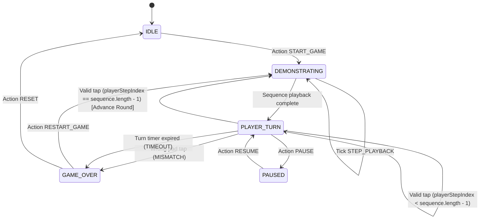

# Data Model: Core Simon Game Loop with User Profiles & SQLite Score Tracking

**Feature**: `001-core-game-loop`
**Date**: 2026-11-12
**Status**: Completed

## 1. Relational Database Schema (SQLite / EF Core)

### 1.1 `Users` Entity
Stores registered user accounts, authentication credentials, and all-time high score metrics.

```sql
CREATE TABLE Users (
    Id TEXT PRIMARY KEY NOT NULL,              -- UUID / GUID formatted as string
    Username TEXT UNIQUE NOT NULL,             -- Unique player handle (3-30 alphanumeric chars)
    PasswordHash TEXT NOT NULL,                -- Secure PBKDF2/SHA-512 hash
    HighestScore INTEGER NOT NULL DEFAULT 0,  -- Player's all-time maximum score achieved
    CreatedAt TEXT NOT NULL,                   -- ISO 8601 timestamp (UTC)
    UpdatedAt TEXT NOT NULL                    -- ISO 8601 timestamp (UTC)
);

CREATE INDEX IX_Users_HighestScore ON Users (HighestScore DESC);
CREATE UNIQUE INDEX IX_Users_Username ON Users (Username);
```

#### Validation Rules
- `Username`: Required, 3–30 characters, matches regex `^[a-zA-Z0-9_]+$`. Case-insensitive uniqueness.
- `PasswordHash`: Required, derived from raw password having minimum 6 characters.
- `HighestScore`: Integer >= 0. Automatically updated via atomic database query when a game session score exceeds current `HighestScore`.

---

### 1.2 `GameScores` Entity
Stores historical record of every completed game session with timestamp and outcome metrics.

```sql
CREATE TABLE GameScores (
    Id TEXT PRIMARY KEY NOT NULL,              -- UUID / GUID formatted as string
    UserId TEXT NOT NULL,                      -- Foreign Key references Users(Id) ON DELETE CASCADE
    Score INTEGER NOT NULL,                    -- Final score achieved (points = rounds completed)
    RoundsCompleted INTEGER NOT NULL,          -- Total successful rounds completed
    DurationSeconds INTEGER NOT NULL,          -- Total active session duration in seconds
    PlayedAt TEXT NOT NULL,                    -- ISO 8601 timestamp of game completion (UTC)
    FOREIGN KEY (UserId) REFERENCES Users(Id) ON DELETE CASCADE
);

CREATE INDEX IX_GameScores_UserId_PlayedAt ON GameScores (UserId, PlayedAt DESC);
CREATE INDEX IX_GameScores_Score ON GameScores (Score DESC);
```

#### Validation Rules
- `Score`: Integer >= 0.
- `RoundsCompleted`: Integer >= 0.
- `DurationSeconds`: Integer >= 0.
- `PlayedAt`: Valid UTC ISO 8601 string. Defaults to `DateTimeOffset.UtcNow`.

---

## 2. Client-Side Runtime Domain Model (TypeScript Engine)

### 2.1 Types & Enums

```typescript
export type ColorPad = 'green' | 'red' | 'yellow' | 'blue';

export type GameStatus =
  | 'IDLE'           // Initial state or reset state
  | 'DEMONSTRATING'  // System playing back audio-visual sequence
  | 'PLAYER_TURN'    // Awaiting player input
  | 'PAUSED'         // Active game paused
  | 'GAME_OVER';     // Mistake made or turn timed out

export interface PadConfig {
  readonly id: ColorPad;
  readonly name: string;
  readonly frequency: number;     // Pitch in Hz
  readonly baseColor: string;     // Hex color code (nominal)
  readonly highlightColor: string;// Hex color code (illuminated)
  readonly keyBinding: string;    // Keyboard key for web accessibility
}

export interface GameEngineState {
  readonly status: GameStatus;
  readonly sequence: readonly ColorPad[];
  readonly currentRound: number;
  readonly currentScore: number;
  readonly playerStepIndex: number;
  readonly activePad: ColorPad | null;
  readonly isError: boolean;
  readonly remainingTurnTimeMs: number;
  readonly highestScore: number;
  readonly sessionStartTime: number | null;
}

export interface UserProfile {
  readonly id: string;
  readonly username: string;
  readonly highestScore: number;
  readonly createdAt: string;
}
```

---

## 3. State Machine Transitions



### Action Reducer Signatures

| Action | Payload | Pre-condition | Next State Effect |
|:---|:---|:---|:---|
| `START_GAME` | `{ seed?: number }` | `IDLE \| GAME_OVER` | Status = `DEMONSTRATING`, sequence = `[randomPad]`, round = 1, score = 0, stepIndex = 0 |
| `PLAYBACK_STEP` | `{ pad: ColorPad \| null }` | `DEMONSTRATING` | `activePad = pad` (triggers audio-visual pulse) |
| `END_DEMONSTRATION` | `none` | `DEMONSTRATING` | Status = `PLAYER_TURN`, `activePad = null`, `remainingTurnTimeMs = 5000` |
| `INPUT_PAD` | `{ pad: ColorPad, timestamp: number }` | `PLAYER_TURN` | If pad == sequence[stepIndex]: advance index or round; else transition to `GAME_OVER` |
| `TIMEOUT` | `none` | `PLAYER_TURN` | Status = `GAME_OVER`, `isError = true` |
| `PAUSE` | `none` | `PLAYER_TURN` | Status = `PAUSED`, freeze timer |
| `RESUME` | `none` | `PAUSED` | Status = `PLAYER_TURN`, unfreeze timer |
| `RECORD_SYNC` | `{ newHighest?: number }` | `GAME_OVER` | Updates `highestScore = max(highestScore, currentScore)` |

