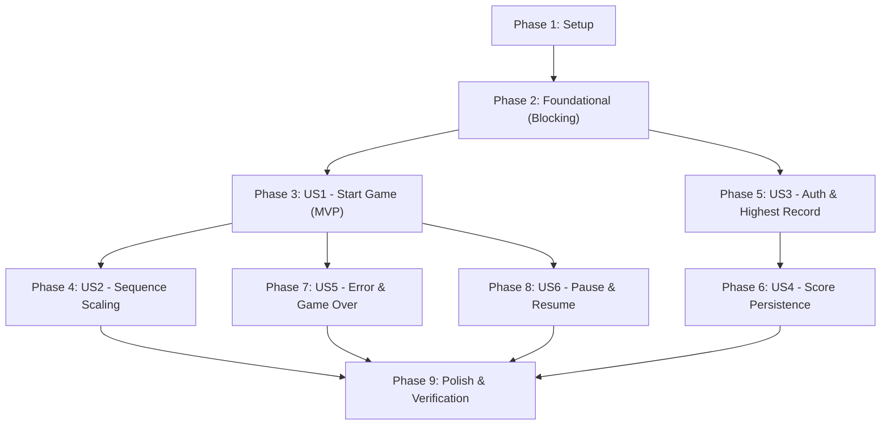

# Tasks: Core Simon Game Loop with User Profiles & SQLite

**Input**: Design documents from `/specs/001-core-game-loop/`
**Prerequisites**: [plan.md](./plan.md), [spec.md](./spec.md), [research.md](./research.md), [data-model.md](./data-model.md), [contracts/openapi.json](./contracts/openapi.json), [contracts/audio-contract.ts](./contracts/audio-contract.ts)
**Tests**: Strict TDD required per Simon Game Constitution Principle IV (*Strict Test-First & Quality Gates*).
**Organization**: Tasks are grouped by user story to enable independent implementation and testing of each story.

## Format: `- [ ] [ID] [P?] [Story?] Description with file path`

- **[P]**: Can run in parallel (different files, no dependencies)
- **[Story]**: Which user story this task belongs to (e.g., [US1], [US2], [US3]...)
- Every task includes an explicit file path

---

## Phase 1: Setup (Shared Infrastructure)

**Purpose**: Monorepo scaffolding, project initialization, toolchains, and containerization.

- [X] T001 Initialize workspace monorepo layout with client and backend root directories
- [X] T002 [P] Initialize React Native and Web client project with TypeScript in client/package.json and client/tsconfig.json
- [X] T003 [P] Initialize .NET 10 solution and projects (Simon.Api, Simon.Core, Simon.Infrastructure, tests) in backend/Simon.sln
- [X] T004 [P] Configure multi-stage backend containerization in backend/Dockerfile and local orchestration in docker-compose.yml
- [X] T005 [P] Configure client linting, formatting, and Vitest test runner in client/vite.config.ts

---

## Phase 2: Foundational (Blocking Prerequisites)

**Purpose**: Core infrastructure and base modules that MUST be complete before ANY user story can proceed.

**⚠️ CRITICAL**: No user story implementation can begin until this phase is complete.

- [X] T006 Setup SQLite DbContext, entity mapping, and EF Core migration in backend/src/Simon.Infrastructure/Data/SimonDbContext.cs
- [X] T007 [P] Define User and GameScore domain entities in backend/src/Simon.Core/Entities/User.cs and backend/src/Simon.Core/Entities/GameScore.cs
- [X] T008 [P] Implement password hashing and JWT token generation service in backend/src/Simon.Infrastructure/Services/AuthService.cs
- [X] T009 [P] Define TypeScript types, PadConfig, and GameEngineState interfaces in client/src/engine/types.ts
- [X] T010 [P] Implement IAudioService and Web Audio API harmonic waveform synthesizer in client/src/audio/web-audio-synth.ts
- [X] T011 Implement React hook useAudioHooks adapter for audio playback in client/src/audio/use-audio.ts
- [X] T012 Setup typed HTTP client and persistent auth token storage in client/src/api/client.ts

**Checkpoint**: Foundation ready — user story implementation can now begin.

---

## Phase 3: User Story 1 - Start Game & Initial Sequence (Priority: P1) 🎯 MVP

**Goal**: Allow a player to start a new game, observe a 1-step audio-visual pattern, reproduce it on the pads, and advance to Round 2.

**Independent Test**: Load client UI, press "Start Game", observe pad illumination and audio tone, tap the matching pad, and verify score increments to 1 and Round 2 begins.

### Tests for User Story 1
- [ ] T013 [P] [US1] Unit test for initial 1-step sequence generation and Round 1 transition in client/tests/engine-init.test.ts
- [ ] T014 [P] [US1] Component test for pad click activation and audio trigger in client/tests/pad-component.test.ts

### Implementation for User Story 1
- [ ] T015 [US1] Implement SimonEngine pure state machine with START_GAME action and sequence generation in client/src/engine/simon-engine.ts
- [ ] T016 [P] [US1] Implement interactive Pad component with color illumination in client/src/components/Pad.tsx
- [ ] T017 [US1] Implement 4-pad SimonBoard layout and round score counter in client/src/components/SimonBoard.tsx
- [ ] T018 [US1] Assemble MVP game flow and controls in client/src/App.tsx

**Checkpoint**: At this point, User Story 1 (MVP) is fully functional and playable independently.

---

## Phase 4: User Story 2 - Progressive Sequence Playback & Difficulty Scaling (Priority: P2)

**Goal**: Retain accumulated sequences, append one random step per round, play back sequences at progressive speeds, and enforce the 180ms speed floor.

**Independent Test**: Complete consecutive rounds (1 through 6+) and verify sequence length increases by 1 each round while playback interval accelerates at milestones.

### Tests for User Story 2
- [ ] T019 [P] [US2] Unit tests for sequence appending and difficulty milestone curves in client/tests/difficulty.test.ts
- [ ] T020 [P] [US2] Integration test for sequence playback timing and input suppression in client/tests/playback-queue.test.ts

### Implementation for User Story 2
- [ ] T021 [US2] Implement difficulty timing calculation and speed milestones in client/src/engine/difficulty.ts
- [ ] T022 [US2] Implement sequence playback queue runner with player input suppression in client/src/engine/playback-runner.ts
- [ ] T023 [US2] Integrate progressive playback and round advancement in client/src/components/SimonBoard.tsx

**Checkpoint**: User Stories 1 and 2 work seamlessly together with progressive difficulty.

---

## Phase 5: User Story 3 - Player Authentication & Highest Record Display (Priority: P2)

**Goal**: Allow players to register and log in with simple credentials, retrieving and displaying their username and personal highest score on the UI.

**Independent Test**: Register a new player, log in, verify username and "Highest Record: 0" appear on the header, log in as a returning user and verify previous highest record is rendered.

### Tests for User Story 3
- [ ] T024 [P] [US3] Integration tests for register, login, and user profile endpoints in backend/tests/Simon.IntegrationTests/AuthEndpointsTests.cs
- [ ] T025 [P] [US3] Unit tests for auth API client and token persistence in client/tests/auth-api.test.ts

### Implementation for User Story 3
- [ ] T026 [US3] Implement ASP.NET Core Minimal API endpoints for /api/auth/register, /api/auth/login, and /api/user/me in backend/src/Simon.Api/Endpoints/AuthEndpoints.cs
- [ ] T027 [US3] Implement client authentication API module in client/src/api/auth-api.ts
- [ ] T028 [P] [US3] Implement AuthModal dialog component for login and account creation in client/src/components/AuthModal.tsx
- [ ] T029 [US3] Implement ScoreHeader component displaying player handle and highest record in client/src/components/ScoreHeader.tsx
- [ ] T030 [US3] Connect authentication state and ScoreHeader to client/src/App.tsx

**Checkpoint**: User Story 3 enables persistent identity and highest score visibility.

---

## Phase 6: User Story 4 - Session Score Recording & Personal Best Updates (Priority: P2)

**Goal**: Save completed game scores with timestamps to SQLite, automatically recalculating and updating the player's highest record on the UI.

**Independent Test**: Complete a game with score 5, verify score and timestamp are written to SQLite; complete a game with score 15, verify UI highest record updates to 15.

### Tests for User Story 4
- [ ] T031 [P] [US4] Integration tests for POST /api/scores and HighestScore recalculation in backend/tests/Simon.IntegrationTests/ScoreEndpointsTests.cs
- [ ] T032 [P] [US4] Unit tests for score submission and offline queue sync in client/tests/scores-api.test.ts

### Implementation for User Story 4
- [ ] T033 [US4] Implement score recording endpoints (/api/scores, /api/scores/my-history) in backend/src/Simon.Api/Endpoints/ScoreEndpoints.cs
- [ ] T034 [US4] Implement client score API service with offline resilience in client/src/api/scores-api.ts
- [ ] T035 [US4] Connect game over event to score submission and high score celebration banner in client/src/App.tsx

**Checkpoint**: User Story 4 persists session history and tracks personal bests.

---

## Phase 7: User Story 5 - Error Detection & Game Over (Priority: P3)

**Goal**: Detect pad mismatches or inactivity timeouts (5s), sound the 42 Hz error buzzer, display the Game Over screen with final score, and provide a restart option.

**Independent Test**: Press an incorrect pad or wait 5 seconds; verify the error sound plays, the Game Over modal shows score and rounds, and "Play Again" restarts Round 1.

### Tests for User Story 5
- [ ] T036 [P] [US5] Unit tests for mismatch detection, turn timer expiration, and error sound trigger in client/tests/game-over.test.ts

### Implementation for User Story 5
- [ ] T037 [US5] Implement 5-second turn countdown timer and TIMEOUT action in client/src/engine/timer.ts
- [ ] T038 [US5] Implement mismatch detection and GAME_OVER transition in client/src/engine/simon-engine.ts
- [ ] T039 [P] [US5] Implement GameOverModal component with score summary and restart button in client/src/components/GameOverModal.tsx
- [ ] T040 [US5] Connect game over modal and restart action in client/src/App.tsx

**Checkpoint**: User Story 5 completes the win/loss cycle and restart loop.

---

## Phase 8: User Story 6 - Pause and Resume Session (Priority: P4)

**Goal**: Allow players to pause active gameplay, freezing the turn timer and pad inputs, and resume without losing session progress.

**Independent Test**: Pause during an active turn, wait 6 seconds (exceeding turn timeout), resume, and verify gameplay continues normally without a timeout error.

### Tests for User Story 6
- [ ] T041 [P] [US6] Unit tests for timer freeze and state preservation on pause/resume in client/tests/pause-resume.test.ts

### Implementation for User Story 6
- [ ] T042 [US6] Implement PAUSE and RESUME reducer transitions in client/src/engine/simon-engine.ts
- [ ] T043 [US6] Add pause/resume button and window defocus auto-pause listener in client/src/components/SimonBoard.tsx

**Checkpoint**: All 6 user stories are fully implemented and testable.

---

## Phase 9: Polish & Cross-Cutting Concerns

**Purpose**: Accessibility validation, container verification, and end-to-end quickstart execution.

- [ ] T044 [P] Implement WCAG 2.1 AA keyboard navigation (keys Q/W/A/S) and high contrast pad styling in client/src/components/Pad.tsx
- [ ] T045 [P] Add Docker compose healthcheck and volume persistence validation in docker-compose.yml
- [ ] T046 Execute complete quickstart validation scenarios from specs/001-core-game-loop/quickstart.md

---

## Dependencies & Execution Order

### Phase Dependencies

- **Setup (Phase 1)**: Can begin immediately.
- **Foundational (Phase 2)**: Depends on Setup; BLOCKS all User Stories.
- **User Story 1 (P1 - MVP)**: Can begin immediately after Phase 2.
- **User Story 2 (P2)**: Extends US1 engine; depends on US1.
- **User Story 3 (P2)**: Independent client/backend auth slice; can run in parallel with US1/US2.
- **User Story 4 (P2)**: Depends on US3 auth endpoints to link scores to user IDs.
- **User Story 5 (P3)**: Depends on US1 state machine to trigger game over.
- **User Story 6 (P4)**: Depends on US1 state machine to pause/resume.
- **Polish (Phase 9)**: Runs after desired user stories are complete.

---

## Parallel Execution Opportunities

### Across User Stories (Multi-Developer / Multi-Agent)
Once Phase 2 (Foundational) is completed:
- **Stream A (Engine & Gameplay)**: User Story 1 (T013–T018) → User Story 2 (T019–T023) → User Story 5 (T036–T040).
- **Stream B (Auth & Backend Persistence)**: User Story 3 (T024–T030) → User Story 4 (T031–T035).

### Within Phases
- In **Phase 1**: T002 (client setup), T003 (.NET solution), T004 (Docker), and T005 (lint/test config) can all execute in parallel.
- In **Phase 2**: T007 (entities), T008 (auth service), T009 (TS types), and T010 (audio synth) can all execute in parallel.
- In **Phase 3**: T013 (engine test), T014 (pad test), and T016 (Pad component) can execute in parallel.
- In **Phase 5**: T024 (backend auth tests), T025 (client auth test), and T028 (AuthModal UI) can execute in parallel.

---

## Implementation Strategy

### MVP First (Phases 1, 2, and 3)
1. Complete Phase 1: Setup.
2. Complete Phase 2: Foundational.
3. Complete Phase 3: User Story 1.
4. **STOP and VALIDATE**: Play the 1-step game on web with audio synthesis. This constitutes a working, demonstrable MVP!

### Incremental Delivery
1. Add User Story 2: Progressive sequence playback and speed tiers.
2. Add User Story 5: Game over feedback and restart loop.
3. Add User Story 3: User registration, login, and highest score UI display.
4. Add User Story 4: Persistent score recording in SQLite with timestamps.
5. Add User Story 6: Pause and resume controls.
6. Complete Phase 9: Polish and quickstart validation.

